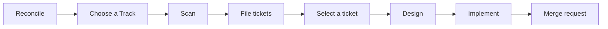

# Continuous Refactoring

> Paying down technical debt. Now. Automatically.

[](https://github.com/Art4/continuous-refactoring/actions/workflows/test-harness.yml)
[](https://github.com/Art4/continuous-refactoring/actions/workflows/skills-validation.yml)
[](LICENSE)

🌐 [continuous-refactoring.de](https://continuous-refactoring.de/)

A portable agent-skill suite for coding agents — [Claude Code](https://claude.com/claude-code),
Cursor, OpenCode — that keeps a software project under **continuous refactoring**. Each call is one **run**: it leads from the
project's open refactoring tickets to one opened merge request, and stops there. You get more work
done by calling again.



Every link of that chain is a **decision point**: the suite shows what it found, the options, and
the one it recommends. By default you decide each time. Say in the call that it should do the run
itself, and it takes its own recommendation at every point instead.

The suite keeps **no state of its own**. Your open tickets are the worklist; merge requests,
declined work and the standing Housekeeping ticket are found by searching your tracker and your
forge on every run. What you change there by hand is simply what the next run finds.

The core is [language-neutral](skills/continuous-refactoring-run/references/tooling-model.md), with tools delivered in **Packs**. A [generic Pack](docs/tooling/packs/generic.md) applies to every project; the first language Pack is a **[general PHP project](docs/tooling/packs/php.md)** (code style, Rector, PHPStan, PHPMD and more, with the diagram of what comes after what), grounded in over 20 years of PHP experience and kept up to date with current best practice; a [Twig Pack](docs/tooling/packs/twig-php.md) adds the templates of a PHP project that uses Twig. Tools you already run — Psalm instead of PHPStan, Laravel Pint instead of PHP CS Fixer — are recognised and not replaced, and a tool the suite does not know joins through a [Pack of your own](docs/playbooks/own-tool.md). The [tooling overview](docs/tooling/README.md) lists every Role, Tool and Pack.

## How it works

A run spends itself on one of four **Tracks**. The suite sorts your open tickets into them and
recommends the first one, in this fixed order, that has something to work on:

| Track | What it does | Recommended when |
|---|---|---|
| **Safety Net** | Sets up the deterministic checks (test runner, coding standards, static analysis, CI, and a backward-compatibility check where your project promises SemVer) that catch a regression before an agent's own judgement has to | one of its tickets can be worked, or the Track was never scanned |
| **Guardrails** | Adds further quality and security tooling once the Safety Net is in place (coverage floor, mess detection, stricter static analysis, …) — a few tools, such as security scanners, only when you ask for them — and takes in a large rule set — a code style, PHPMD — rule by rule, in merge requests a person can review | the same, once Safety Net is fulfilled |
| **Housekeeping** | Recurring maintenance — dependency currency, tooling-deprecation cleanup, a secret scan over the Git history — plus the small refactoring ideas left as comments on its ticket | its open ticket is due, or it is not set up yet |
| **Investigation** | Structural refactoring: works the tickets that ask for one, or explores the code for hot spots and deepening opportunities and proposes tickets | nothing above has work |

Each of the two tooling Tracks is scanned once. From then on its tickets are the record: a tool without an open ticket
counts as done, and a recurring Housekeeping task re-checks whether a tool went missing. Before a
ticket is worked the suite checks again whether the work is still needed — a tool you set up by hand
closes its ticket instead of being set up twice.

While a run is going, the suite tells you what it is doing: a sentence before and after every step,
and one line for every change to your tracker, your forge or your repository. Details:
[Run playbook](docs/playbooks/run.md), [Track playbook](docs/playbooks/tracks.md),
[Architecture](docs/architecture.md).

## Skills

| Skill | Purpose |
|---|---|
| `continuous-refactoring` | The **Driver**: one round after another, each a run, its review and any rework, with a cadence between them, until an end |
| `continuous-refactoring-run` | One run, from the open tickets to an opened merge request |
| `continuous-housekeeping` | One Housekeeping run and nothing else — no Track choice, so it can be put on a schedule |

You or a schedule start the Driver; an agent calls `continuous-refactoring-run` or `continuous-housekeeping`. The
[Driver playbook](docs/playbooks/driver.md) has its settings and what waits for you.

Everything else — choosing a Track, scanning, selecting, planning, implementing, onboarding — is
reference material these load when a run reaches it. Where your project has its own skills for
planning and implementing, the suite recommends those and uses its own procedures only as a
fallback.

## Installing in a target project

Three symlinks, side by side in the target's skills folder:

```bash
mkdir -p <target>/.agents/skills
ln -s /path/to/continuous-refactoring/skills/continuous-refactoring <target>/.agents/skills/
ln -s /path/to/continuous-refactoring/skills/continuous-refactoring-run <target>/.agents/skills/
ln -s /path/to/continuous-refactoring/skills/continuous-housekeeping <target>/.agents/skills/
```

Or copy the three folders. To make the suite available everywhere, link all three into your agent's global
skills folder (e.g. `~/.config/opencode/skills/`) the same way. They belong together:
`continuous-refactoring` and `continuous-housekeeping` read files of `continuous-refactoring-run`.

> **Works with other skills, needs none.** The suite is compatible with engineering skills such as [mattpocock/skills](https://github.com/mattpocock/skills) (see [aihero.dev](https://www.aihero.dev/)): where a project has skills for planning or implementing, a run offers to use them. Without any, the first `/continuous-refactoring-run` writes the issue-tracker file itself, and plans and implements its own way.

**Any issue tracker works** that your tracker file describes: `docs/agents/issue-tracker.md`, or the file your `AGENTS.md` names in its place. GitHub, GitLab and local Markdown files come with a ready-made template. For another one — Redmine, Jira — onboarding asks how the suite's few operations work there (how tickets are searched, how a finished one is recognised) and writes the answers into that file. Tickets and merge requests may live in different systems: the tracker is whatever that file describes, merge requests live where the Git remote points.

## Quick start

1. **Call `/continuous-refactoring`.** On a project the suite has not seen, it first asks where your tickets live and how the operations work there, and writes that as one section into your tracker file (`docs/agents/issue-tracker.md` unless your `AGENTS.md` names another) — commit that file. The run ends there; commit, then call it again.
2. **Answer the onboarding.** Each question comes with a recommendation, so "yes" moves on.
3. **Let it work.** The next call starts the Driver: by itself it works up to five rounds, 30 minutes apart, reviews each merge request and merges none of them. Say otherwise in the call ("merge", "ten rounds", "no pause"). For one run alone, `/continuous-refactoring-run` asks at every decision; `/continuous-refactoring-run do it yourself` takes one ticket from selection to an opened merge request.
4. **Steer it in the call, in your own words:** a Track ("work on Guardrails"), a restriction ("only the Rector tools"), a ticket ("ticket 42"), a [Pack of your own](docs/playbooks/own-tool.md) for a tool the suite does not know ("a Pack of its own for Deptrac").
5. **Review and merge** what the suite opens. The Driver stops once more than three of its merge requests are open; a run alone has no such limit.
6. **Housekeeping:** `/continuous-housekeeping` sets its mechanism up on the first call and works the due ticket afterwards. The suite schedules nothing itself — point your own scheduler (`/schedule`, `/loop`, cron) at any of the commands.

## Upgrading

Pull the suite's checkout; the symlinks follow it. What a version changes, and the steps a breaking
change needs in your project, are in the [CHANGELOG](CHANGELOG.md) — coming from 0.6.0 or earlier,
read the 0.7.0 entry first.

## Where things live

Everything is in your project, your tracker and your forge — nothing in the conversation, nothing in files of the suite.

- **Work to do:** open tickets on your tracker
- **Work in review:** open merge requests on your forge, found from their tickets
- **Declined work:** a closed ticket or a file with the reason, in the place your tracker section names under **Rejected**
- **Recurring maintenance:** the Housekeeping template, a file in your repository, and the one open Housekeeping ticket made from it
- **How the tracker is reached:** the `## Refactoring operations` section of your tracker file, including the optional bullets — a **Candidate** mark, **Ready after plan**, **Rejected**
- **Tools of your own:** a Pack in your repository, named under **Tooling Pack** in that section
- **Focus areas and refactoring goal:** two lines you add to `AGENTS.md` (or `CLAUDE.md`), any time
- **Domain language and decisions:** your own glossary and ADR directory, where your project keeps them

## Documentation

| Doc | For |
|---|---|
| [Driver playbook](docs/playbooks/driver.md) | Letting the suite go on by itself — its settings, what waits for you, how it ends |
| [Run playbook](docs/playbooks/run.md) | Steering a run as a human — the call, the decision points, how a run ends |
| [Track playbook](docs/playbooks/tracks.md) | How the four Tracks are chosen, scanned and worked |
| [Own-tool playbook](docs/playbooks/own-tool.md) | Adding a tool the suite does not know, as a Pack of your own |
| [Housekeeping playbook](docs/playbooks/housekeeping.md) | The maintenance Track — template, standing ticket, rhythm |
| [Tooling](docs/tooling/README.md) | Every Role, Tool and Pack the suite knows, with a diagram per Pack |
| [Architecture](docs/architecture.md) | The two skills, their references, the tooling tree |
| [FAQ](docs/FAQ.md) | Why the suite is designed the way it is |
| [Known limitations](docs/known-limitations.md) | Limits without a suite-side fix, plus troubleshooting |
| [Operations reference](skills/continuous-refactoring-run/references/refactoring-operations.md) | The operations the suite needs from a tracker, with the templates |
| [CONTEXT.md](CONTEXT.md) | The suite's vocabulary |

## Contributing

Bug reports, feature requests, and pull requests are welcome — see [CONTRIBUTING.md](CONTRIBUTING.md).

## License

MIT — see [LICENSE](LICENSE).

---

Built by [Artur Weigandt](https://weigandtlabs.de) — PHP refactoring, freelance.
