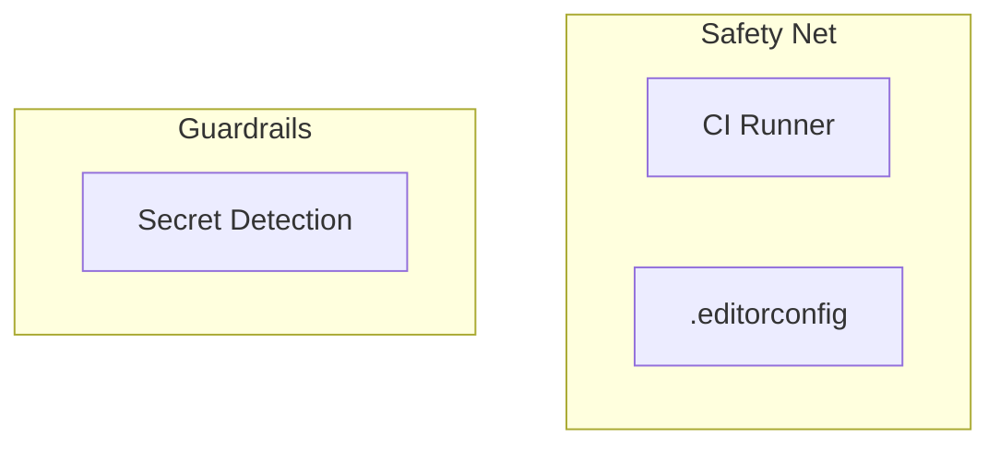

<!-- Generated from the Packs by scripts/tooling_docs.py — do not edit. Regenerate with: python3 scripts/tooling_docs.py -->

# Pack `generic`

Applies when: Always.

## Diagram

## Tools

| Tool | Status | Roles | Uses | Minimum runtime | Details |
| --- | --- | --- | --- | --- | --- |
| CI Runner (`ci-runner`) | recommended | Continuous Integration | GitHub Actions / GitLab CI | – | [packs/generic/ci-runner.md](../../../skills/continuous-refactoring/references/packs/generic/ci-runner.md) |
| .editorconfig (`editorconfig`) | recommended | Editor Settings | EditorConfig | – | [packs/generic/editorconfig.md](../../../skills/continuous-refactoring/references/packs/generic/editorconfig.md) |
| Secret Detection (`secret-detection`) | recommended | Secret Scanning | any secret scanner | – | [packs/generic/secret-detection.md](../../../skills/continuous-refactoring/references/packs/generic/secret-detection.md) |

## Stages

| Stage | Tool | Track | Requires | Waits for | Applies when |
| --- | --- | --- | --- | --- | --- |
| CI Runner (`ci-runner`) | `ci-runner` | Safety Net | – | – | – |
| .editorconfig (`editorconfig`) | `editorconfig` | Safety Net | – | – | – |
| Secret Detection (`secret-detection`) | `secret-detection` | Guardrails | – | – | – |
