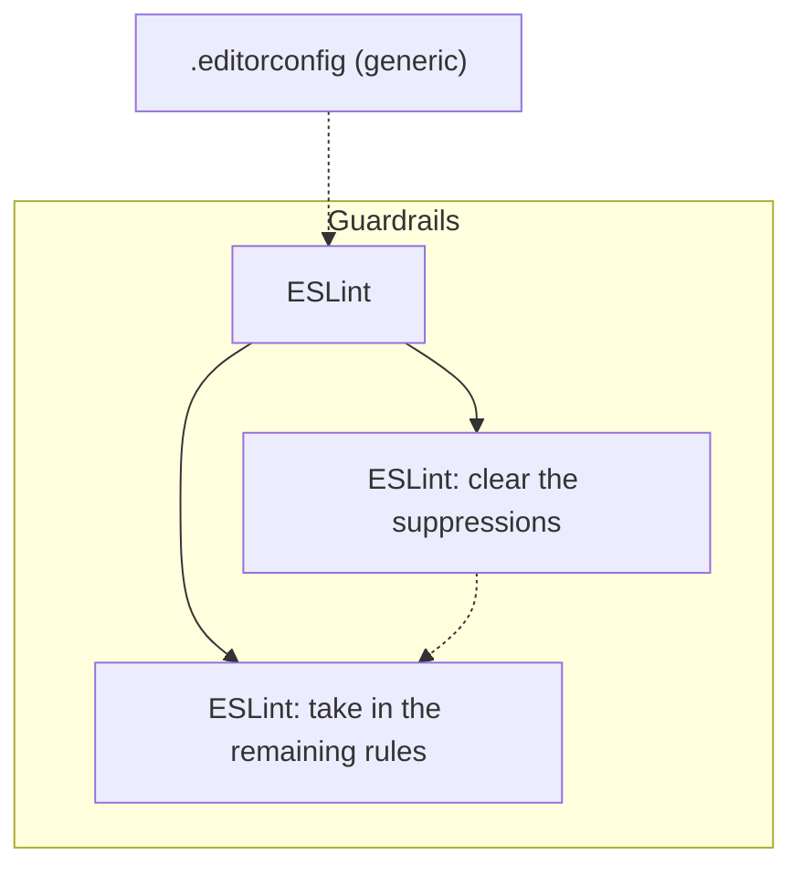

<!-- Generated from the Packs by scripts/tooling_docs.py — do not edit. Regenerate with: python3 scripts/tooling_docs.py -->

# Pack `js`

Applies when: The repository holds JavaScript of its own: a package.json, or at least one *.js, *.mjs or *.cjs file outside node_modules/ and vendor/. Minified files (*.min.js) and the folders a build writes to are not its own; TypeScript is not covered yet.

## Diagram

Solid arrow: requires · dashed arrow: waits for · solid outline: recommended · dashed outline: on request · dotted outline: recognized

## Tools

| Tool | Status | Roles | Uses | Minimum runtime | Details |
| --- | --- | --- | --- | --- | --- |
| ESLint (`eslint`) | recommended | Static Analysis | ESLint | – | [packs/js/eslint.md](../../../skills/continuous-refactoring-run/references/packs/js/eslint.md) |

## Stages

| Stage | Tool | Track | Requires | Waits for | Applies when |
| --- | --- | --- | --- | --- | --- |
| ESLint (`eslint-adoption`) | `eslint` | Guardrails | – | `editorconfig` | – |
| ESLint: clear the suppressions (`eslint-suppressions`) | `eslint` | Guardrails | `eslint-adoption` | – | – |
| ESLint: take in the remaining rules (`eslint-rollout`) | `eslint` | Guardrails | `eslint-adoption` | `eslint-suppressions` | – |
