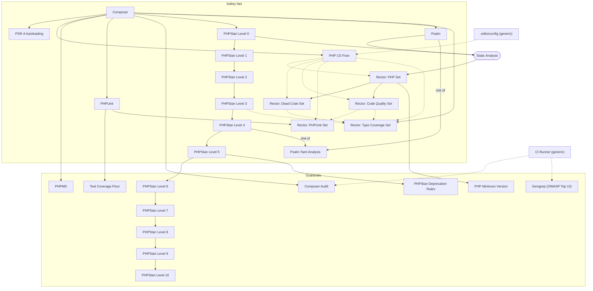

<!-- Generated from the Packs by scripts/tooling_docs.py — do not edit. Regenerate with: python3 scripts/tooling_docs.py -->

# Pack `php`

Applies when: The repository contains PHP code: a composer.json (or composer/composer.json), or at least one *.php file outside vendor/.

## Diagram

## Tools

| Tool | Status | Roles | Uses | Minimum runtime | Details |
| --- | --- | --- | --- | --- | --- |
| Composer (`composer`) | recommended | Package Management | Composer | – | [php-tooling-tree/composer.md](../../../skills/continuous-refactoring/references/php-tooling-tree/composer.md) |
| PSR-4 Autoloading (`psr-4`) | recommended | Autoloading | – | – | [php-tooling-tree/psr-4.md](../../../skills/continuous-refactoring/references/php-tooling-tree/psr-4.md) |
| PHP CS Fixer (`php-cs-fixer`) | recommended | Code Style | php-cs-fixer | php 5.3 | [php-tooling-tree/php-cs-fixer.md](../../../skills/continuous-refactoring/references/php-tooling-tree/php-cs-fixer.md) |
| PHPMD (`phpmd`) | recommended | Code Smell Detection | PHPMD | – | [php-tooling-tree/phpmd.md](../../../skills/continuous-refactoring/references/php-tooling-tree/phpmd.md) |
| PHPUnit (`phpunit`) | recommended | Testing | PHPUnit | php 5.3 | [php-tooling-tree/phpunit.md](../../../skills/continuous-refactoring/references/php-tooling-tree/phpunit.md) |
| Test Coverage Floor (`coverage-floor`) | recommended | Test Coverage | PHPUnit | – | [php-tooling-tree/coverage-floor.md](../../../skills/continuous-refactoring/references/php-tooling-tree/coverage-floor.md) |
| Composer Audit (`composer-audit`) | recommended | Dependency Audit | composer audit | php 7.2 | [php-tooling-tree/composer-audit.md](../../../skills/continuous-refactoring/references/php-tooling-tree/composer-audit.md) |
| PHPStan (`phpstan`) | recommended | Static Analysis | PHPStan | php 7.0 | [php-tooling-tree/phpstan.md](../../../skills/continuous-refactoring/references/php-tooling-tree/phpstan.md) |
| Psalm (`psalm`) | recognized | Static Analysis | vimeo/psalm | – | [php-tooling-tree/psalm.md](../../../skills/continuous-refactoring/references/php-tooling-tree/psalm.md) |
| Rector (`rector`) | recommended | Automated Refactoring | Rector | – | [php-tooling-tree/rector.md](../../../skills/continuous-refactoring/references/php-tooling-tree/rector.md) |
| PHP Minimum Version (`php-minimal-version`) | recommended | Runtime Floor | – | – | [php-tooling-tree/php-minimal-version.md](../../../skills/continuous-refactoring/references/php-tooling-tree/php-minimal-version.md) |
| Psalm Taint Analysis (`psalm-taint-analysis`) | recommended | Taint Analysis | vimeo/psalm | – | [php-tooling-tree/psalm.md](../../../skills/continuous-refactoring/references/php-tooling-tree/psalm.md) |
| Semgrep (OWASP Top 10) (`semgrep`) | recommended | Static Security Analysis | Semgrep | – | [php-tooling-tree/semgrep.md](../../../skills/continuous-refactoring/references/php-tooling-tree/semgrep.md) |

## Stages

| Stage | Tool | Track | Requires | After | Applies when |
| --- | --- | --- | --- | --- | --- |
| Composer (`composer`) | `composer` | Safety Net | – | – | – |
| PSR-4 Autoloading (`psr-4`) | `psr-4` | Safety Net | `composer` | – | – |
| PHP CS Fixer (`php-cs-fixer`) | `php-cs-fixer` | Safety Net | `composer` | `editorconfig` | – |
| PHPMD (`phpmd`) | `phpmd` | Guardrails | `composer` | – | – |
| PHPUnit (`phpunit`) | `phpunit` | Safety Net | `composer` | – | – |
| Test Coverage Floor (`coverage-floor`) | `coverage-floor` | Guardrails | `phpunit` | – | – |
| Composer Audit (`composer-audit`) | `composer-audit` | Guardrails | `composer` | `ci-runner` | The repository's composer.json requires at least one real package; platform pseudo-packages (php, hhvm, ext-*, lib-*, composer-plugin-api, composer-runtime-api) do not count. |
| PHPStan Level 0 (`phpstan-level-0`) | `phpstan` | Safety Net | `composer` | – | – |
| PHPStan Level 1 (`phpstan-level-1`) | `phpstan` | Safety Net | `phpstan-level-0` | – | – |
| PHPStan Level 2 (`phpstan-level-2`) | `phpstan` | Safety Net | `phpstan-level-1` | – | – |
| PHPStan Level 3 (`phpstan-level-3`) | `phpstan` | Safety Net | `phpstan-level-2` | – | – |
| PHPStan Level 4 (`phpstan-level-4`) | `phpstan` | Safety Net | `phpstan-level-3` | – | – |
| PHPStan Level 5 (`phpstan-level-5`) | `phpstan` | Safety Net | `phpstan-level-4` | – | – |
| PHPStan Level 6 (`phpstan-level-6`) | `phpstan` | Guardrails | `phpstan-level-5` | – | – |
| PHPStan Level 7 (`phpstan-level-7`) | `phpstan` | Guardrails | `phpstan-level-6` | – | – |
| PHPStan Level 8 (`phpstan-level-8`) | `phpstan` | Guardrails | `phpstan-level-7` | – | – |
| PHPStan Level 9 (`phpstan-level-9`) | `phpstan` | Guardrails | `phpstan-level-8` | – | – |
| PHPStan Level 10 (`phpstan-level-10`) | `phpstan` | Guardrails | `phpstan-level-9` | – | – |
| PHPStan Deprecation Rules (`phpstan-deprecation-rules`) | `phpstan` | Guardrails | `phpstan-level-5` | – | – |
| Psalm (`psalm`) | `psalm` | Safety Net | `composer` | – | – |
| Rector: PHP Set (`rector-php-set`) | `rector` | Safety Net | `static-analysis` (Role) | `php-cs-fixer` | – |
| Rector: Dead Code Set (`rector-dead-code`) | `rector` | Safety Net | `rector-php-set` | `php-cs-fixer` | – |
| Rector: Code Quality Set (`rector-code-quality`) | `rector` | Safety Net | `rector-php-set` | `php-cs-fixer` | – |
| Rector: PHPUnit Set (`rector-phpunit-set`) | `rector` | Safety Net | `phpunit` | `rector-code-quality`, `php-cs-fixer` | – |
| Rector: Type Coverage Set (`rector-type-coverage`) | `rector` | Safety Net | `composer` | `rector-dead-code`, `rector-code-quality`, `php-cs-fixer`, `phpstan-level-3` | – |
| PHP Minimum Version (`php-minimal-version`) | `php-minimal-version` | Guardrails | `rector-php-set` | – | – |
| Psalm Taint Analysis (`psalm-taint-analysis`) | `psalm-taint-analysis` | Safety Net | one of `phpstan-level-4`, `psalm` | – | – |
| Semgrep (OWASP Top 10) (`semgrep`) | `semgrep` | Guardrails | – | `ci-runner` | – |
