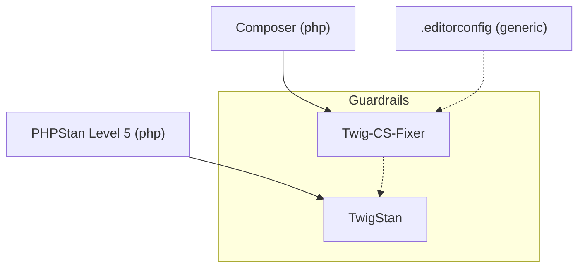

<!-- Generated from the Packs by scripts/tooling_docs.py — do not edit. Regenerate with: python3 scripts/tooling_docs.py -->

# Pack `twig-php`

Applies when: The PHP Pack applies and composer.json (or, for an indirect requirement, composer.lock) requires twig/twig or a package that brings Twig along, such as symfony/twig-bundle. The file extension of the templates does not decide.

## Diagram

## Tools

| Tool | Status | Roles | Uses | Minimum runtime | Details |
| --- | --- | --- | --- | --- | --- |
| Twig-CS-Fixer (`twig-cs-fixer`) | recommended | Code Style | Twig-CS-Fixer | – | [packs/twig-php/twig-cs-fixer.md](../../../skills/continuous-refactoring/references/packs/twig-php/twig-cs-fixer.md) |
| TwigStan (`twigstan`) | recommended | Static Analysis | TwigStan | – | [packs/twig-php/twigstan.md](../../../skills/continuous-refactoring/references/packs/twig-php/twigstan.md) |

## Stages

| Stage | Tool | Track | Requires | Waits for | Applies when |
| --- | --- | --- | --- | --- | --- |
| Twig-CS-Fixer (`twig-cs-fixer`) | `twig-cs-fixer` | Guardrails | `composer` | `editorconfig` | – |
| TwigStan (`twigstan`) | `twigstan` | Guardrails | `phpstan-level-5` | `twig-cs-fixer` | – |
